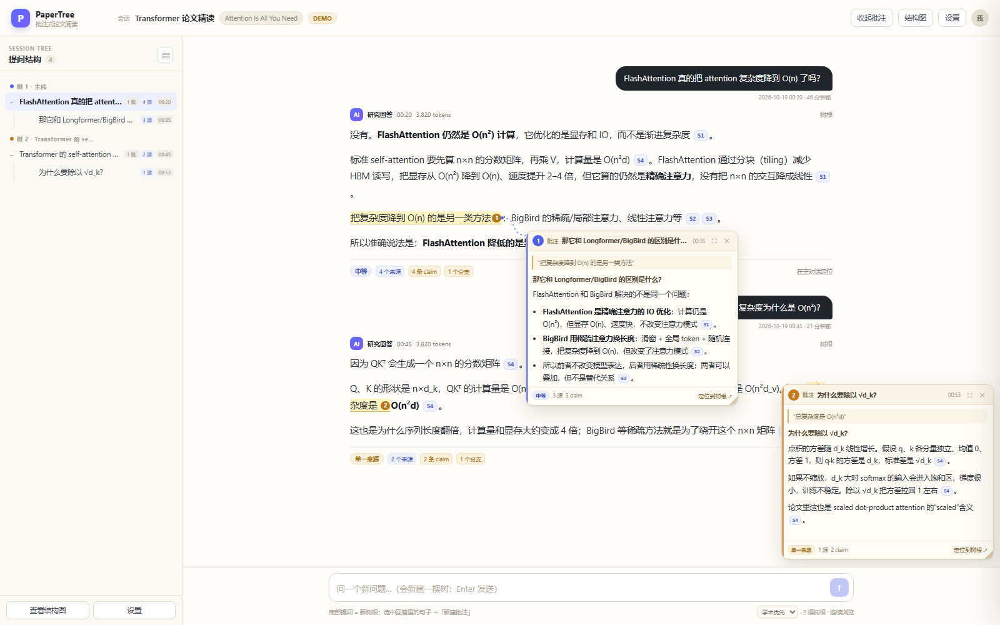

# PaperTree

[](LICENSE)
[](https://nodejs.org/)

[简体中文](README.md) · English

PaperTree is an open-source, local-first **paper-reading workspace** that combines a normal chat transcript with a question tree and sentence-level annotation notes.

Ask a question, get a researched answer with citations, then select any sentence and open a sticky note. Ask a follow-up inside the note to build a nested annotation tree. All root questions stay in one continuous, scrollable transcript.



## Highlights

- Sentence-level annotations with drag/resize/focus/maximize and exact text anchors.
- Nested annotations revealed progressively, one level at a time.
- Sidebar question tree and full-screen structure graph.
- Continuous transcript of every root question, ordered by time.
- DeepSeek Search/Fetch + OpenAlex, Crossref, arXiv, and Semantic Scholar with source tiers, retraction/preprint flags, claim evidence, and a source drawer.
- Local JSON storage; the desktop API key is encrypted with Electron `safeStorage`; no telemetry.
- DEMO mode without an API key.

## Run from source

Requirements: Node.js 24+.

```bash
# from the cloned/downloaded repository root
cd paper-tree
npm ci
npm run desktop      # Electron window
# or: npm run start  # web dev server at http://127.0.0.1:4317
```

A prebuilt Windows installer will be available on the repository's **Releases** page when published. It does not require Node.js.

## API key

Use **Settings** in the desktop app, or copy `app/.env.example` to `app/.env` for web development. Without a key the app runs in DEMO mode.

Local data: `%APPDATA%\PaperTree\{config.json,db.json,server.log}`.

Do not commit API keys, `.env`, `app/data/`, logs, or private-paper screenshots. See [SECURITY.md](SECURITY.md).

## Development

```bash
npm ci
npm run check
npm run start
npm run dist   # Windows NSIS installer in dist/
```

The local server has zero npm runtime dependencies and uses Node.js built-ins.

## Status

Early-stage. PDF annotation, strict NLI claim verification, streaming answers, and sync are not implemented yet. See the [changelog](CHANGELOG.md).

## Contributing

Read [CONTRIBUTING.md](CONTRIBUTING.md) and [CODE_OF_CONDUCT.md](CODE_OF_CONDUCT.md). Report vulnerabilities privately via [SECURITY.md](SECURITY.md).

## License

[MIT](LICENSE) © 2026 PaperTree contributors.

## Docs

- [中文 README](README.md)
- [Product analysis](docs/product-analysis.md)
- [Research tools design](docs/research-tools-design.md)
- [Local web mode](app/README.md)
