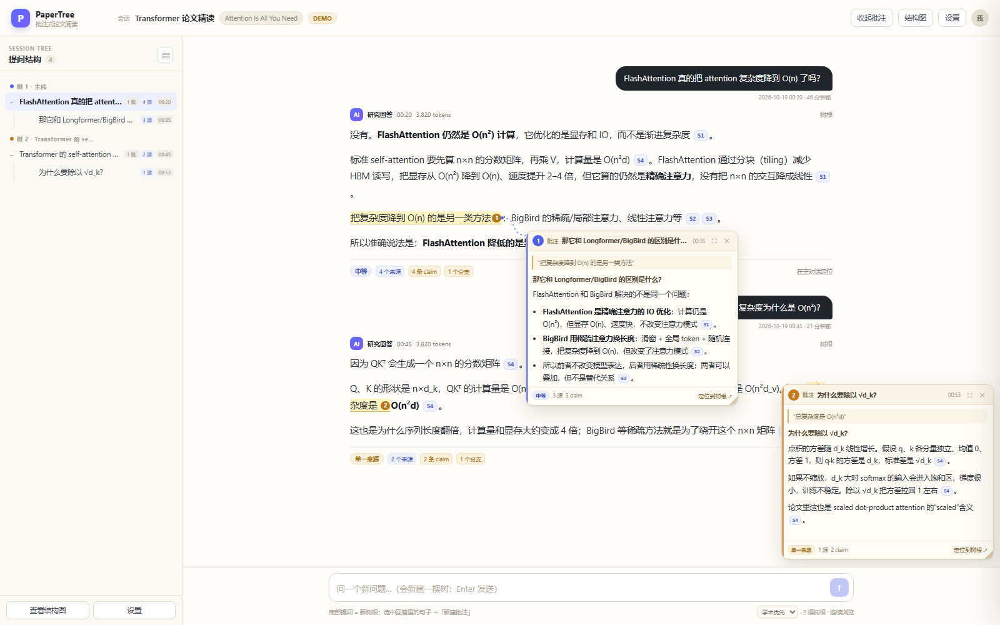

# PaperTree

[](LICENSE)
[](https://nodejs.org/)
[](#privacy)

[English](README.en.md) · 简体中文

**PaperTree** is an open-source, local-first paper-reading workspace for asking questions about a paper, branching follow-ups, and annotating answers with sticky notes. It combines a normal chat transcript with a tree of questions, marginal-style annotations, and traceable academic citations.

Ask a question → get a researched answer with sources → select any sentence → open a note → ask a follow-up inside that note. Every root question stays in one continuous scrollable conversation.



## Features

- **Sentence-level annotations** — select text in an answer, create a note, drag/resize it, focus it, or maximize it. The note is connected to the exact highlighted text, including multi-line highlights.
- **Nested annotations** — select text inside a note to create a child note. Notes reveal progressively, one level at a time.
- **Tree of questions** — every root question is kept; a sidebar tree shows roots, branches, timestamps, source counts, and annotation counts.
- **Continuous transcript** — all root Q&A pairs are rendered in one window ordered by question time, so you can scroll back through the whole session without switching trees.
- **Structure graph** — full-screen tree overview with pan/zoom and click-to-navigate.
- **Research with citations** — DeepSeek Search/Fetch plus OpenAlex, Crossref, arXiv, and Semantic Scholar; source tiers, peer-review/preprint/retraction flags, claim evidence levels, and a source drawer.
- **Local-first data** — local JSON store, zero runtime npm dependencies for the server, no telemetry. The API key is encrypted with Electron `safeStorage` in the desktop build.
- **DEMO mode** — no key required; a built-in example tree lets you try the UI immediately.

More screenshots: [maximized note](app/screenshot-note-max.png) · [minimal annotation state](app/screenshot-note-minimal.png) · [sidebar collapsed](app/screenshot-sidebar-folded.png) · [structure graph](app/screenshot-graph.png)

## Install

### Prebuilt Windows installer

When a GitHub Release is published, download `PaperTree-Setup-*.exe` from the repository's **Releases** page. The installer is self-contained and does not require Node.js.

> The installer is not code-signed yet. Windows SmartScreen may show “Unknown publisher”; choose **More info → Run anyway**. Code signing is planned.

### Run from source

Requirements: **Node.js 24+** and npm.

```powershell
# from the cloned/downloaded repository root
cd paper-tree
npm ci
npm run desktop
```

For web-only development:

```powershell
npm run start
# http://127.0.0.1:4317
```

`npm run desktop` opens the Electron window. `npm run start` serves the same UI in a browser for faster iteration.

## API key and privacy

Without a key the app runs in **DEMO** mode with an embedded example tree. To use DeepSeek:

1. Open **设置 / Settings** in the app and paste a DeepSeek API key, or create `app/.env` from `app/.env.example` for web development.
2. The desktop key is encrypted with Electron `safeStorage` (Windows DPAPI) and stored locally.
3. Questions/selected excerpts are sent to the configured model and search providers. Do not send confidential or unpublished material unless permitted.

Local data paths:

```text
%APPDATA%\PaperTree\config.json    encrypted API key
%APPDATA%\PaperTree\db.json        sessions
%APPDATA%\PaperTree\server.log     local server log
```

No API keys, `.env` files, local session data, logs, or private-paper screenshots belong in git. See [SECURITY.md](SECURITY.md).

## How the interaction works

- Select a sentence in an answer → **＋ 新建批注** → a medium note appears.
- Left-drag the note header: it focuses first, then moves. Scroll the transcript: the note stays anchored to its text.
- Click a note title: focus highlight, no resize; other notes stay as they are.
- Click a highlighted phrase or its number: expand only that note from the minimal state.
- Click inside a note's highlighted text: open the next nested note, one level at a time.
- `⛶` maximizes a note; the sidebar stays sharp and usable. `✕` minimizes it to just the highlight and number.
- Connectors use fixed ports at the midpoint of each side and switch sides when other cards block the path. A child connector is one continuous curve that may cover its parent card but stops at the child edge.
- Dragging/resizing a note moves only that window; only its related connectors update.
- The bottom composer always creates a new root question and appends it to the continuous transcript.

## Architecture

```text
desktop/                 Electron main process, preload, icons
app/server.mjs           local HTTP server + JSON/SSE API
app/lib/                 DeepSeek, academic adapters, research pipeline, store
app/public/annotate.*    annotation workspace (main UI)
app/public/index.*       legacy map + reader view (debug)
docs/                    product analysis and research-tool design
prototype/               early static prototype
scripts/check.mjs        dependency-free syntax/metadata checks
```

The server deliberately uses **Node.js built-ins only** at runtime. Electron and electron-builder are development dependencies for packaging.

## Development

```powershell
npm ci
npm run check      # syntax + package metadata
npm run start      # web dev server
npm run desktop    # Electron window
```

Build a Windows installer:

```powershell
npm run dist
```

Outputs (not committed): `dist/PaperTree-Setup-<version>.exe` and `dist/win-unpacked/PaperTree.exe`.

Smoke test in DEMO mode without a key:

```powershell
$env:DEMO = "1"
npm run start
# open http://127.0.0.1:4317, create a note, open the structure graph
```

## Status / limitations

This is an early project. Not yet implemented:

- PDF upload, PDF text selection, and page anchoring;
- strict claim-level NLI cross-validation (current verdicts are an engineering approximation from source count, tier, and quote matching);
- streaming answer text (retrieval trace is live; final answer is returned at once);
- automatic tree summaries/session memory and `@` references across branches;
- multi-model routing, sync, mobile apps, and auto-updates.

## Contributing

Issues and pull requests are welcome. Please read [CONTRIBUTING.md](CONTRIBUTING.md) and [CODE_OF_CONDUCT.md](CODE_OF_CONDUCT.md). For security reports, follow [SECURITY.md](SECURITY.md).

## License

[MIT](LICENSE) © 2026 PaperTree contributors.

## Docs

- [Product analysis](docs/product-analysis.md)
- [Research tools design](docs/research-tools-design.md)
- [Local web mode](app/README.md)
- [Changelog](CHANGELOG.md)
