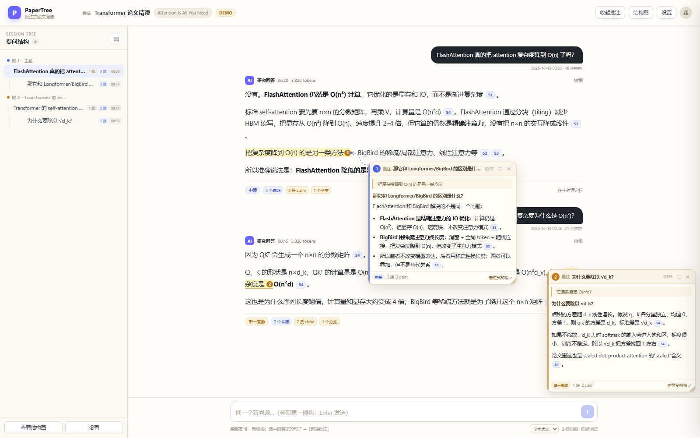

# PaperTree（本地 Web 调试模式）

> 完整项目说明、安装包和构建方式见根目录 [README.md](../README.md)。本文件只说明 `npm start` 的本地 Web 调试模式。

论文精读的「批注式」对话树。选中句子新建便签，便签连线到原句；侧边栏是提问树，结构图查看全貌。



## 运行

需要 Node.js 24+，**不需要 npm install**。

```powershell
# 从仓库根目录运行
Copy-Item app\.env.example app\.env
# 编辑 app\.env，填入 DEEPSEEK_API_KEY（不填也能跑演示模式）
node app/server.mjs
```

打开 <http://127.0.0.1:4317>。

或者：

```powershell
.\app\start.ps1
```

`start.ps1` 会在 `.env` 不存在时自动复制模板。

## 配置

| 变量 | 说明 |
|---|---|
| `DEEPSEEK_API_KEY` | 不填则进入 DEMO 模式（内置示例树） |
| `DEEPSEEK_BASE_URL` | 默认 `https://api.deepseek.com` |
| `DEEPSEEK_MODEL` | 默认 `deepseek-flash` |
| `DEEPSEEK_STRONG_MODEL` | 默认 `deepseek-v4-pro`（预留） |
| `OPENALEX_MAILTO` | OpenAlex/Crossref 礼貌池邮箱 |
| `PORT` | 默认 4317 |
| `DATA_FILE` | 可选，默认 `app/data/db.json` |

API Key 只在服务端读取，不会发送到浏览器。

## 这一版已经实现

- **批注便签**：选中回答里的任意句子 →「＋ 新建批注」→ 便签出现，虚线连到原句，原句高亮编号；
- 便签可拖动、右下角临时缩放；左键按下先聚焦这张，再开始移动；滚动正文时批注随原句一起滚动；
- 点击标题聚焦高亮，尺寸不变，其它便签不变暗；聚焦时也可拖动；
- `⛶` 最大化，主对话退到背景、侧栏保持清晰；`✕` 最小化到只剩高亮和序号，没有小标签中间态；
- 点原句高亮/序号从最小态展开这一张；「定位到树根」滚动到所属树根；
- 层级展开：点父批注高亮只展开对应批注；再点它正文里的高亮才展开下一层，不会一次弹出全部子批注；
- 连线使用四边中点固定接口，自动检测卡片遮挡并换边；拖动/缩放哪张批注，只动这张窗口并更新相关线，其它窗口不动；
- 二级批注是一条连续曲线，画在上层：可压父窗口，但贴到子窗口边缘为止，不穿进直接子窗口内部，也不会被无关窗口遮挡；
- 子批注默认排在父批注外侧；层级 z 顺序保证子窗口在父窗口上方；
- 二级批注：在便签回答里继续选句生成子便签；父便签保持原尺寸、聚焦/最大化状态，不变透明；父批注最小化会连带全部子批注；
- 主对话：所有树根按提问时间连续排布，滚轮浏览全部上下文；引用 chip、来源抽屉、claim 证据等级；
- 左侧树状目录：折叠/展开、时间/来源/分支数；点树根定位、点批注展开；收起按钮在侧栏头部，收起后左上角出现面板按钮；
- 右上角「收起批注」：最小态只保留原句高亮和序号，点高亮单独展开一张；「显示批注」恢复全部；
- 右侧「结构图」：全屏树图、平移缩放、点击节点回主对话；
- 底部大输入框：每次提问都是一棵新树根，普通 Agent 式体验；
- 窗口缩放自适应：侧边栏、聊天列、便签位置与尺寸；
- 批注三态：最小化、中、最大；中状态缩放不持久，切换状态后回到默认中尺寸；
- 重新打开恢复最后状态：聚焦/最大化/哪些最小化；
- DeepSeek Search / Fetch + OpenAlex / Crossref / arXiv / Semantic Scholar；
- 来源分级 A1/A2/B/C、同行评审/预印本/撤稿标记；
- 本地 JSON 持久化、设置里粘贴论文原文、示例树。

## 这一版没做

- PDF 上传/划词/页码锚定（下一步）；
- 严格的 claim 级 NLI 交叉验证（当前是「模型给 claim + 来源数/tier + quote 匹配」）；
- 树摘要、会话记忆自动更新、`@` 引用其它分支；
- 流式输出回答（当前先显示检索轨迹，回答一次性返回）；
- 多用户、登录、同步、移动端。

## 已知限制

- Semantic Scholar 经常 429，会自动跳过；建议后续加 API key。
- 学术源目前主要用摘要，不是所有论文都能拿到 OA 全文。
- 没有配置 key 时，示例树是假数据；提问返回演示回答。
- 一次提问最多 4 个检索 query、6 个来源；延迟通常 5–20 秒。

## 数据

- 默认数据库：`app/data/db.json`（已被 .gitignore 忽略）；
- 设置里有「载入示例树」和「清空所有节点」；
- 删除 `app/data/db.json` 可完全重置。
